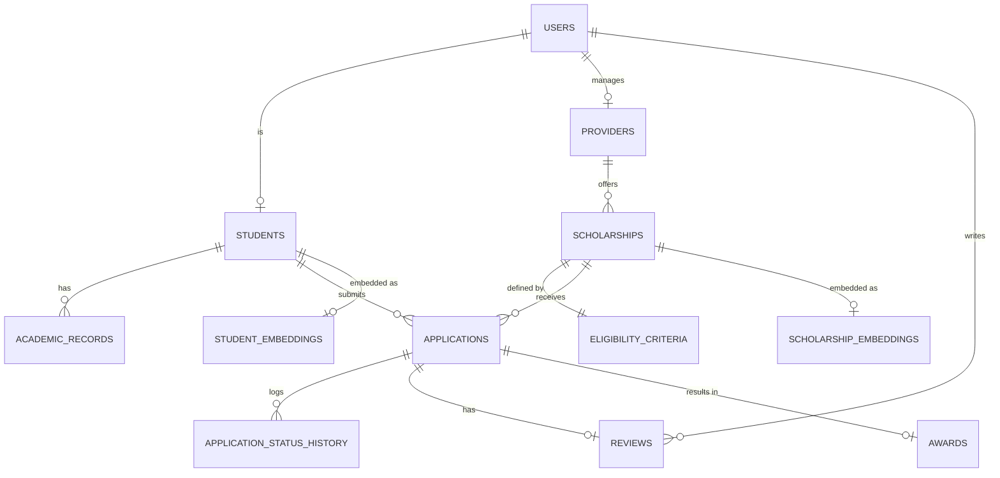

# Database design

## ER diagram
Paste into https://mermaid.live to render, or redraw in draw.io, and save the picture as `docs/er_diagram.png`.

Student and Scholarship have a many-to-many relationship, resolved by APPLICATIONS (which carries status, statement and applied_at).

## Relational schema (PK underlined as PK, FK marked)
- users(**user_id PK**, email UNIQUE, password_hash, role, created_at)
- providers(**provider_id PK**, user_id FK→users UNIQUE, name UNIQUE, type)
- students(**student_id PK**, user_id FK→users UNIQUE, full_name, dob, gender, category, state, annual_family_income, disability, course, year_of_study, cgpa, interests, phone)
- academic_records(**record_id PK**, student_id FK→students, semester, sgpa, UNIQUE(student_id, semester))
- scholarships(**scholarship_id PK**, provider_id FK→providers, title, description, amount, total_budget, seats, deadline, is_active, search_tsv)
- eligibility_criteria(**scholarship_id PK, FK→scholarships**, max_income, min_cgpa, allowed_categories[], allowed_states[], allowed_courses[], min_year, max_year, gender, disability_only)
- applications(**application_id PK**, student_id FK→students, scholarship_id FK→scholarships, status, statement, applied_at, UNIQUE(student_id, scholarship_id))
- application_status_history(**history_id PK**, application_id FK→applications, old_status, new_status, changed_at)
- reviews(**review_id PK**, application_id FK→applications UNIQUE, reviewer_id FK→users, score, comments, reviewed_at)
- awards(**award_id PK**, application_id FK→applications UNIQUE, amount, awarded_at)
- scholarship_embeddings(**scholarship_id PK, FK→scholarships**, embedding vector(384))
- student_embeddings(**student_id PK, FK→students**, embedding vector(384)) (reserved for future use)

## Data dictionary (key columns and constraints)
| Table | Column | Type | Constraint |
|---|---|---|---|
| users | email | varchar(120) | UNIQUE, NOT NULL, regex CHECK |
| users | role | varchar(10) | CHECK in (student, reviewer, admin) |
| users | password_hash | text | NOT NULL, bcrypt hash |
| students | dob | date | CHECK dob < today |
| students | gender | varchar(10) | CHECK in (male, female, other) |
| students | category | varchar(10) | CHECK in (GEN, OBC, SC, ST, EWS) |
| students | annual_family_income | numeric(12,2) | CHECK >= 0 |
| students | year_of_study | int | CHECK 1 to 6 |
| students | cgpa | numeric(4,2) | CHECK 0 to 10 |
| students | phone | varchar(15) | CHECK digits only (added with ALTER) |
| scholarships | amount | numeric(10,2) | CHECK > 0 |
| scholarships | total_budget | numeric(12,2) | CHECK >= 0 |
| scholarships | seats | int | CHECK >= 0 |
| scholarships | search_tsv | tsvector | generated from title and description |
| eligibility_criteria | min_year, max_year | int | CHECK min_year <= max_year |
| applications | status | varchar(12) | CHECK in (submitted, under_review, approved, rejected, withdrawn) |
| applications | (student_id, scholarship_id) | | UNIQUE, so no duplicate applications |
| reviews | score | int | CHECK 0 to 100 |
| awards | amount | numeric(10,2) | CHECK > 0 |
| scholarship_embeddings | embedding | vector(384) | NOT NULL, HNSW index (cosine) |

## SQL implementation (where each concept lives)
| Concept | File and object |
|---|---|
| CREATE, primary and foreign keys, constraints | `db/01_schema.sql` |
| ALTER | `ALTER TABLE students ADD COLUMN phone` in `01_schema.sql` |
| DROP | `DROP TABLE tmp_demo` in `01_schema.sql` |
| Indexes | `idx_app_student`, `idx_sch_deadline` (B-tree), `idx_sch_tsv` (GIN), `idx_sch_emb` (HNSW) |
| Function | `fn_eligibility_check(student_id)` in `02_logic.sql` |
| Triggers | `before_application_insert`, `after_application_change` in `02_logic.sql` |
| Transaction | `sp_approve_application(app_id, reviewer_id)` in `02_logic.sql` |
| Views | `v_scholarship_stats`, `v_student_dashboard` in `02_logic.sql` |
| Seed data | `db/03_seed.sql` |
| Demo queries | `db/04_queries.sql` |

## DML used by the application
| Operation | Where |
|---|---|
| INSERT | register, apply, create scholarship, notifications |
| UPDATE | reject application, edit scholarship (amount, seats, deadline), approval changes seats and budget |
| DELETE | delete scholarship (removes criteria and embedding by cascade; blocked by foreign key if applications exist) |
| SELECT | eligibility, search, dashboards, stats |

## Important queries
- Eligibility with reasons: `SELECT * FROM fn_eligibility_check(1);`
- JOIN, GROUP BY, HAVING: providers with more than one scholarship (`04_queries.sql`)
- Subquery: scholarships above the average amount
- Approval rate above 50 percent: `SELECT * FROM v_scholarship_stats WHERE approval_rate > 50;`
- Full-text search: `SELECT title FROM scholarships WHERE search_tsv @@ plainto_tsquery('english','robotics');`
- Hybrid vector query (used by `/api/recommend`):
```sql
SELECT s.title, 1 - (e.embedding <=> $1::vector) AS similarity
FROM scholarship_embeddings e JOIN scholarships s USING (scholarship_id)
WHERE s.scholarship_id = ANY($2)
ORDER BY e.embedding <=> $1::vector LIMIT 10;
```

## Integrity mechanisms
- Triggers reject applications after the deadline, with no seats, to inactive scholarships, or from ineligible students.
- `sp_approve_application` locks the application and scholarship rows (`FOR UPDATE`) and inserts the award, reduces seats and budget and updates the status in one transaction; any error rolls everything back.
- CHECK constraints reject invalid values such as CGPA 15.
