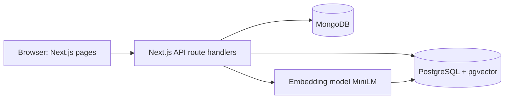

# Smart Scholarship Eligibility and Recommendation System

## 1. Problem statement
Students miss scholarships because eligibility rules (income, CGPA, category, state, course, year, gender, disability) are scattered across many sources and hard to compare. Students cannot easily tell which scholarships they qualify for, why they fail the others, or which ones suit them best.

## 2. Objectives
- Check a student against every scholarship rule and show Eligible or Not eligible with the failed reasons.
- Recommend scholarships using semantic similarity between the student's interests and scholarship descriptions, combined with deadline urgency and award amount.
- Let reviewers create, edit, delete, approve and reject, with consistent seats and budget.
- Keep an audit trail and notify students of decisions.
- Enforce data integrity at the database level.

## 3. Scope
In scope: student registration and login, eligibility check, search and filter, semantic recommendations, applications, reviewer workflow, award transaction, admin statistics, audit logs and notifications.
Out of scope: real document upload, email or SMS delivery, payment processing, integration with government portals.

## 4. Functional requirements
| ID | Requirement |
|---|---|
| FR1 | Student registers with academic, income and interest details; passwords are hashed |
| FR2 | Users log in and see pages according to role (student, reviewer, admin) |
| FR3 | System lists every scholarship with eligibility status and reasons for failure |
| FR4 | Student searches scholarships by keyword (full-text) and filters by eligibility and amount |
| FR5 | System recommends eligible scholarships ranked by similarity, urgency and amount |
| FR6 | Student applies once per scholarship; late, full or ineligible applications are blocked |
| FR7 | Every application status change is recorded in a history table |
| FR8 | Reviewer approves (award, seats and budget updated atomically) or rejects an application |
| FR9 | Reviewer creates, edits and deletes scholarships with eligibility rules |
| FR10 | Student receives a notification when an application is decided |
| FR11 | Admin views statistics from PostgreSQL and activity analytics from MongoDB |

## 5. Database choice and justification
| Data | Database | Justification |
|---|---|---|
| Users, students, scholarships, applications, awards, reviews | PostgreSQL | Structured, related data that needs foreign keys, constraints, triggers and ACID transactions (seats and budget must never go wrong) |
| Scholarship and student text meaning | pgvector in PostgreSQL | Semantic search over free text; keeping vectors in PostgreSQL lets one query combine SQL eligibility filters with vector similarity |
| Audit logs, notifications, flexible rules, document metadata | MongoDB | Write-heavy events with varying fields, no joins needed, and aggregation pipelines suit analytics |

## 6. System architecture

The browser never talks to a database. All access goes through route handlers that check the JWT cookie and the user's role. Credentials live in `.env.local`.

## 7. Security and integrity
- Passwords stored as bcrypt hashes; JWT in an httpOnly cookie.
- All SQL uses parameterized queries.
- Role checks on every API route (student, reviewer, admin).
- Database-level validation: CHECK, NOT NULL, UNIQUE, foreign keys and triggers.
- Secrets in environment variables; `.env.local` is git-ignored.

## 8. Advanced database features
Transactions (`sp_approve_application`), views (`v_scholarship_stats`, `v_student_dashboard`), stored functions (`fn_eligibility_check`), triggers (application check, status history), indexing (B-tree, GIN, HNSW), full-text search, MongoDB aggregation, vector similarity search.

## 9. Application screenshots
Add images to `docs/screenshots/`: login, register, student dashboard (eligibility, recommendations, search, filter), my applications, reviewer queue, manage scholarships, create scholarship, admin dashboard, notification.

## 10. Conclusion and future enhancements
The system combines relational rules, semantic search and event storage to solve a real problem, going beyond CRUD with an eligibility engine, hybrid ranking and transactional awarding.
Future work: document upload and verification, email and SMS reminders, per-student embedding storage, multi-language descriptions, appeals workflow, rule editor using the MongoDB rules collection.

## 11. Individual contributions
| Member | Database work | Application work |
|---|---|---|
| A | PostgreSQL schema, constraints, indexes, eligibility function, triggers, approval transaction, views, seed data | Authentication, registration, student dashboard, eligibility, apply |
| B | MongoDB collections, indexes, aggregations, embeddings and pgvector retrieval | Reviewer and admin pages, search, notifications, recommendations, scholarship edit and delete |
